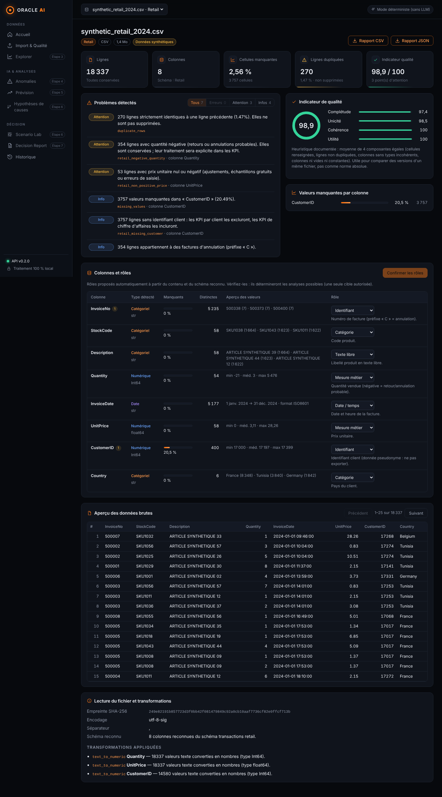

# ORACLE AI

**Plateforme d'intelligence décisionnelle explicable** — import et qualité des données,
détection d'anomalies, prévision, hypothèses de causes, simulation de scénarios et
recommandations traçables. Chaque résultat expose sa méthode, ses hypothèses et ses limites.



## État du projet

| Étape | Contenu | Statut |
|---|---|---|
| 1 | Squelette FastAPI + React/Vite, configuration typée, SQLite, tests, CI | ✅ Livré |
| 2 | Import CSV/XLSX sécurisé (multi-feuilles), profilage qualité, rôles de colonnes, export, historique | ✅ Livré (v0.2.1) |
| 3 | KPI & exploration | ⏳ À venir |
| 4 | Anomalies : médiane/MAD, IQR, Isolation Forest | ⏳ À venir |
| 5 | Prévision : split chronologique, baselines, MAE/RMSE/MASE | ⏳ À venir |
| 6 | Scenario Lab, Decision Engine, hypothèses causales | ⏳ À venir |
| 7 | Rapport de décision, tests E2E | ⏳ À venir |
| 8 | Docker, vidéo, démo complète | ⏳ À venir |

Les écrans des modules à venir sont présents dans l'interface mais affichent explicitement
« non encore implémenté » : aucun résultat n'est simulé.

## Stack

- **Backend** : Python 3.11+, FastAPI, Pydantic v2, pandas, SQLAlchemy 2 (SQLite), uv
- **Frontend** : React 19, TypeScript, Vite, React Router
- **Qualité** : pytest, Ruff, Vitest, oxlint, GitHub Actions (Linux + Windows)

## Installation sous Windows (PowerShell)

Prérequis : [Git](https://git-scm.com/), [Node.js 22 LTS](https://nodejs.org/) et
[uv](https://docs.astral.sh/uv/) (gère Python automatiquement) :

```powershell
powershell -ExecutionPolicy ByPass -c "irm https://astral.sh/uv/install.ps1 | iex"
```

```powershell
git clone https://github.com/<votre-compte>/oracle-ai.git
cd oracle-ai
Copy-Item .env.example .env

# Backend
cd backend
uv sync                      # crée .venv avec Python 3.11 et les dépendances verrouillées
uv run pytest                # tests
cd ..

# Frontend
cd frontend
npm ci
npm test
cd ..
```

## Lancement

Deux terminaux PowerShell :

```powershell
# Terminal 1 — API sur http://127.0.0.1:8000 (docs : /docs)
cd backend
uv run uvicorn app.main:create_app --factory --reload --port 8000
```

```powershell
# Terminal 2 — interface sur http://localhost:5173
cd frontend
npm run dev
```

Ouvrez http://localhost:5173, puis cliquez sur **Analyser** sous un dataset de démonstration
ou importez votre propre fichier `.csv` / `.xlsx`.

Sous Linux/macOS, les mêmes commandes fonctionnent (`cp .env.example .env`).

## Vérifications

```powershell
cd backend;  uv run ruff check .; uv run ruff format --check .; uv run pytest
cd ../frontend; npm run lint; npm run typecheck; npm test; npm run build
```

## Données

- `datasets/samples/` : **données 100 % synthétiques** générées par
  `scripts/generate_samples.py` (schémas de colonnes inspirés d'UCI Online Retail et AI4I 2020).
- Jeux officiels UCI : téléchargés localement via `scripts/download_datasets.py` dans
  `datasets/raw/`, jamais commités. Détails, licences et précautions : [datasets/README.md](datasets/README.md).

## Confidentialité

Traitement 100 % local. Les fichiers importés restent en mémoire du backend (durée limitée,
libérables) ; SQLite ne conserve que des métadonnées. Aucun appel à un service externe ;
le LLM, prévu plus tard, sera optionnel et désactivé sans clé.

## Limites connues (v0.2.0)

- Classeurs Excel : première feuille par défaut, ou toutes les feuilles si elles ont exactement
  les mêmes colonnes ; formules non évaluées.
- Les dates texte sont détectées parmi une liste de formats courants ; en cas d'ambiguïté
  jour/mois, l'outil le signale et retient jour/mois par défaut.
- Les copies de travail sont perdues au redémarrage du backend (réimport nécessaire).
- L'indicateur de qualité est une heuristique interne, pas une norme.
- Pas encore testé sur les jeux UCI réels ni installé sur un poste Windows réel (la CI
  Windows le vérifiera).

## Documentation

- [Architecture](docs/architecture.md) · [Dictionnaire de données](docs/data_dictionary.md) ·
  [Évaluation](docs/evaluation.md) · [Captures](docs/screenshots/)

## Licence

À choisir après vérification des licences des dépendances et des jeux de données.
